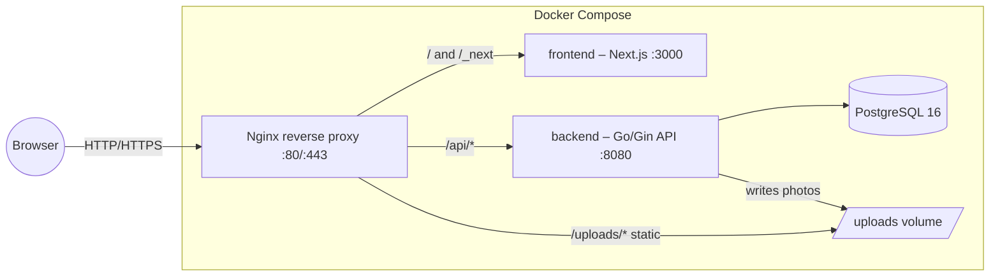
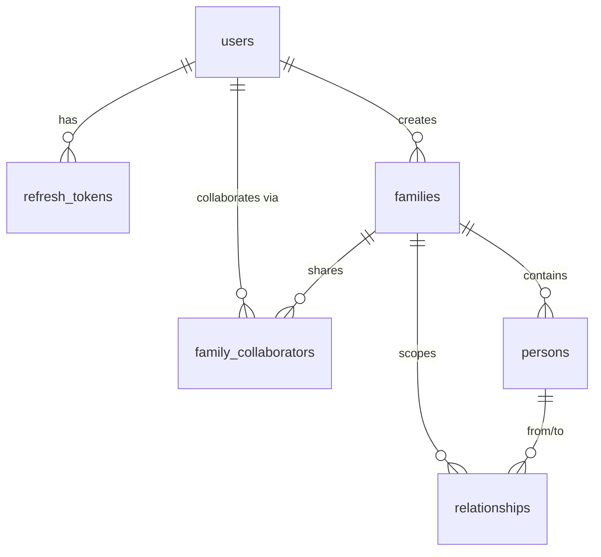

# ARCHITECTURE.md — System Design

How the Family Tree application is built. For business context read
`CONTEXT.md`; for coding standards read `DEVELOPMENT_RULES.md`. Significant
decisions are recorded as ADRs in `docs/adr/`.

## 1. System overview



Single origin: the browser only ever talks to Nginx, so cookies are
first-party and CORS is a non-issue in production (see ADR-0005). In
development the Next.js dev server proxies `/api/*` and `/uploads/*` to the
backend via rewrites, preserving the same-origin model.

### Environments

| | Development | Production |
|---|---|---|
| Command | `docker compose up` (with `COMPOSE_FILE` set in `.env`, merges `docker-compose.dev.yml`) | `docker compose -f docker-compose.yml up -d` |
| Backend | `air` hot reload, source bind-mounted | Static binary, distroless-style Alpine image, non-root |
| Frontend | `next dev` (HMR), source bind-mounted | `next build` standalone output, non-root |
| Postgres | Port exposed to host | Internal network only |
| Nginx | Runs too (parity with prod) | Sole public entry point |
| Hybrid option | Run only Postgres in Docker; run Go/Next natively with `backend/.env` + `frontend/.env.local` | — |

## 2. Backend architecture (Clean Architecture)

Dependency rule: **source code dependencies point inward.** `domain` depends
on nothing else in the app; `service` depends on `domain`; `repository` and
`handler` depend on `domain` (and implement its interfaces); `cmd/api` wires
everything together.

```
handler (HTTP, DTOs)  ──►  domain  ◄──  repository (GORM/Postgres)
        │                    ▲
        └──────►  service ───┘        (service implements domain service
                                       interfaces, consumes repo interfaces)
```

### Folder responsibilities

| Path | Responsibility | Forbidden |
|------|----------------|-----------|
| `cmd/api` | Entry point: config, logger, DB, DI wiring, HTTP server, graceful shutdown | Business logic |
| `cmd/migrate` | Migration CLI (`up`, `down N`, `version`, `force`, `new <name>`) | — |
| `internal/domain` | Entities, enums, repository interfaces, service interfaces, service input/output structs, domain errors | HTTP, SQL, framework code |
| `internal/repository` | GORM implementations of repository interfaces, DB connection/pool, migration runner. Translates driver errors → domain errors | Business rules, HTTP types |
| `internal/service` | ALL business logic; implements domain service interfaces; owns transactions | gin/HTTP types, SQL |
| `internal/handler` | Gin handlers: bind+validate DTOs, call services, map domain errors → HTTP responses | Business logic, DB access |
| `internal/middleware` | request-id, structured logging, recovery, CORS, security headers, body limit, JWT auth (`RequireAuth`), RBAC (`RequireRole`) | Business logic |
| `internal/routes` | Route registration, middleware ordering | Handler logic |
| `internal/config` | Typed config loaded from env (+ optional `.env` in dev), fail-fast validation | Reading env anywhere else |
| `internal/validation` | Custom `validator` rules (e.g. `strong_password`) registered into Gin's binding engine | — |
| `pkg/` | Domain-agnostic, reusable: `token` (JWT + opaque tokens), `password` (bcrypt), `response` (JSON envelope), `pagination` | Imports from `internal/` |
| `migrations/` | Sequential SQL migrations, embedded into the binary via `embed.FS` | Editing applied migrations |

Pragmatic deviation from textbook Clean Architecture: domain entities carry
GORM struct tags to avoid a duplicate persistence-model layer. Rationale and
trade-offs in ADR-0002.

### Request lifecycle (example: `POST /api/v1/auth/login`)

1. Nginx proxies to Gin. Middleware chain: RequestID → Logger → Recovery →
   SecurityHeaders → BodyLimit → CORS.
2. `handler.AuthHandler.Login` binds `LoginRequest` (Gin binding +
   validator tags) → 422 with field errors on failure.
3. Handler calls `domain.AuthService.Login(ctx, input)`.
4. `service.authService` loads the user via `domain.UserRepository`, verifies
   bcrypt hash, issues JWT access token + opaque refresh token, persists the
   refresh token hash via `domain.RefreshTokenRepository`.
5. Handler sets the refresh cookie, wraps the result in the JSON envelope,
   returns 200. Domain errors map centrally to HTTP codes
   (`handler/helpers.go`).

### Error strategy

- Domain sentinel errors (`domain.ErrNotFound`, `ErrEmailTaken`,
  `ErrInvalidCredentials`, `ErrTokenInvalid`, `ErrForbidden`, …) are the only
  errors services return for expected failures; anything else is treated as
  internal.
- Repositories translate infrastructure errors (e.g.
  `gorm.ErrRecordNotFound`, Postgres `23505`) into domain errors.
- One mapping table in `handler/helpers.go` converts domain errors → HTTP
  status + stable machine-readable error `code`. Internal errors are logged
  with the request id; clients receive a generic message.

### Configuration & logging

- `config.Load()` reads env vars (loading `backend/.env` first in dev if
  present), applies defaults, and **fails fast** on invalid/missing required
  values (`JWT_SECRET` ≥ 32 chars, DB settings).
- Logging via stdlib `slog`: JSON in production, text in development.
  Request logs include request id, method, path, status, latency, client IP,
  and user id when authenticated.

## 3. Authentication & authorization

Details: ADR-0004; API reference: `docs/api/auth.md`.

- **Access token**: JWT HS256, 15 min TTL (`ACCESS_TOKEN_TTL`), claims
  `sub` (user id), `role`, `jti`, `iss`. Sent as `Authorization: Bearer`.
  Held in frontend memory only — never persisted to storage.
- **Refresh token**: 256-bit opaque random string; only its SHA-256 hash is
  stored (`refresh_tokens` table). Delivered as an `HttpOnly; SameSite=Lax`
  cookie (`ft_refresh`, `Secure` in production). TTL `REFRESH_TOKEN_TTL`
  (default 30 days).
- **Rotation & reuse detection**: every `/auth/refresh` revokes the presented
  token and issues a new pair. Presenting an already-revoked token revokes
  ALL of the user's refresh tokens (stolen-token signal) and returns 401.
- **RBAC**: global role (`admin`/`user`) is embedded in JWT claims and
  enforced by `middleware.RequireRole`. The site has **one** royal family;
  write access requires global `admin` **or** an `owner`/`editor` row in
  `family_collaborators` for that family (enforced in the service layer).
  Public tree reads use `/api/v1/public/*` with no JWT (ADR-0007).
- **Password hashing**: bcrypt, configurable cost (`BCRYPT_COST`, default 12).
- **Bootstrap admin**: on startup, if `ADMIN_EMAIL` + `ADMIN_PASSWORD` are
  set and the account doesn't exist, it is created with role `admin`.
  The royal family is seeded and owned by that admin (or the first admin).
- Frontend flow: axios interceptor attaches the access token; on 401 it
  performs a single-flight `POST /auth/refresh` (cookie-based) and retries
  once; if refresh fails it clears state and redirects to `/login`.
  `src/middleware.ts` protects `/studio` and `/admin/*` based on cookie
  presence (UX only — real enforcement is always API-side). Public routes
  `/` and `/explore` need no session.

## 4. Frontend architecture

### Data flow (strict, one direction)

```
page/component ──► hook (React Query) ──► service ──► lib/api-client (axios)
     ▲                                                        │
     └────────────── typed data / errors ◄────────────────────┘
```

- **Components never call axios/fetch.** They consume hooks.
- **Hooks** (`hooks/`) wrap React Query (`useQuery`/`useMutation`), own cache
  keys (registered centrally in `lib/query-keys.ts`) and side effects
  (redirects, cache invalidation).
- **Services** (`services/`) are the only modules calling the API client;
  they unwrap the `{success, data, error}` envelope and return typed data.
- **Forms**: React Hook Form + Zod resolver, schemas in `lib/validations/`.
  Server field errors (422 details) are merged into form state.
- **State**: server state in React Query; the access token in a tiny memory
  store (`lib/auth-token.ts`); minor UI state in component state. No global
  state library until proven necessary.

### Routing map (App Router)

| Route | Group | Access | Purpose |
|-------|-------|--------|---------|
| `/` | — | public | Aceh royal branded landing |
| `/explore` | — | public | Immersive 3D tree viewer (R3F) |
| `/login`, `/register` | `(auth)` | public | Auth forms |
| `/request-access` | `(dashboard)` | authenticated | Descendant edit-access request |
| `/studio` | `(dashboard)` | editor/admin | Mutate persons & relationships |
| `/admin/requests` | `(dashboard)` | super-admin | Approve/reject access requests |

Route groups: `(auth)` centered card; `(dashboard)` header + client auth
guard (`useMe`). Explore uses a minimal chrome layout.

### Styling & UI

- TailwindCSS v4 (CSS-first config in `src/app/globals.css` via `@theme`;
  no `tailwind.config` file — see ADR-0006). Public brand: deep teal /
  indigo sea tones with warm gold accents (Aceh maritime/sultanate).
- 3D canvas: `three` + `@react-three/fiber` + `@react-three/drei`
  (ADR-0007), dynamically imported on `/explore`.
- Reusable primitives in `components/ui/`; feature UI in
  `components/{tree,persons,admin}/`.

## 5. API architecture

- Base path `/api/v1` (versioned from day one). Health endpoints `/healthz`
  (liveness) and `/readyz` (DB ping) sit outside versioning.
- JSON envelope on every response:
  `{"success": true, "data": …, "meta": …}` or
  `{"success": false, "error": {"code", "message", "details"}}`.
- Validation failures: HTTP 422, `code=VALIDATION_ERROR`,
  `details = {field: message}`.
- Pagination: `?page=&per_page=` (max 100), responses carry
  `meta: {page, per_page, total, total_pages}`.
- Stable error codes registry in `docs/api/README.md`.
- Full conventions + endpoint reference: `docs/api/`.

## 6. Database architecture

PostgreSQL 16. Schema is owned by SQL migrations (`backend/migrations/`,
golang-migrate, embedded in the binary; applied on startup when
`RUN_MIGRATIONS=true`, or via `cmd/migrate`). GORM AutoMigrate is forbidden
(ADR-0003). Full docs + ERD: `docs/DATABASE.md`.



Conventions: UUID PKs (`gen_random_uuid()` default, app also sets IDs),
`timestamptz` for all times, soft delete (`deleted_at`) on `users`,
`families`, `persons`; hard delete for `refresh_tokens`,
`family_collaborators`, `relationships` (edges/grants are re-creatable, and
soft-deleted edges would corrupt tree queries). `citext` for emails with a
partial unique index (`WHERE deleted_at IS NULL`).

Relationship encoding: `parent` edges are directed (from = parent,
to = child); `spouse` edges are stored once in canonical order
(`from_person_id < to_person_id`, enforced by CHECK). Ancestor/descendant
queries use recursive CTEs (examples in `docs/DATABASE.md`).

## 7. Deployment architecture

Target: one Linux VM with Docker. Full runbook: `docs/DEPLOYMENT.md`.

- **Nginx** (only published port): routes `/api/*` → backend,
  `/uploads/*` → shared volume (static, cache headers), everything else →
  frontend (with WebSocket upgrade for HMR in dev). Applies gzip, security
  headers + CSP (ADR-0010), `client_max_body_size 10m`, and rate limiting on
  `/api/` (stricter on `/api/v1/auth/`). TLS via Let's Encrypt (commented
  server block + runbook).
- **Backend**: multi-stage build → static binary on Alpine, non-root user,
  healthcheck on `/healthz`. Applies migrations on boot (single instance).
- **Frontend**: Next.js standalone output, non-root, healthcheck.
- **Postgres**: internal network only; named volume `postgres_data`;
  backup via `scripts/backup.sh` (cron documented).
- **Volumes**: `postgres_data`, `uploads_data` (backend read-write, nginx
  read-only).
- **Images**: local builds by default. Production pulls
  `ghcr.io/twkakbar/family-tree-*` (ADR-0011). The VM does not compile.
- **Monitoring**: `/healthz` + `/readyz` (versioned JSON); cron script
  `scripts/health-monitor.sh` and external uptime on `/readyz`.

## 8. CI/CD

- `ci.yml` (push to main + PRs): backend job (gofmt check, `go vet`,
  `go test -race`, build), frontend job (`npm ci`, ESLint, `tsc --noEmit`,
  `next build`), docker job (image build sanity), **e2e job** (Compose up +
  Playwright smoke against nginx).
- `deploy.yml`: after CI succeeds on `main` (or a manual run), builds and
  pushes images to GHCR, then SSHes into the VM and runs
  `docker compose pull` + `up -d` with `docker-compose.prod.yml` (ADR-0011).
  No image build on the VM.
- Required secrets/variables documented in `docs/DEPLOYMENT.md`.

## 9. ADR index

| ADR | Decision |
|-----|----------|
| `docs/adr/0001` | Monorepo layout |
| `docs/adr/0002` | Clean Architecture with GORM tags on domain entities |
| `docs/adr/0003` | golang-migrate with embedded SQL migrations (no AutoMigrate) |
| `docs/adr/0004` | JWT access in memory + rotating opaque refresh token in httpOnly cookie |
| `docs/adr/0005` | Same-origin routing via Nginx (prod) and Next rewrites (dev) |
| `docs/adr/0006` | TailwindCSS v4 CSS-first configuration |
| `docs/adr/0007` | Public Aceh royal tree + React Three Fiber |
| `docs/adr/0008` | JSON export/import into singleton royal family |
| `docs/adr/0009` | Password reset / email_verified without SMTP |
| `docs/adr/0010` | CSP + hardened security headers at nginx |
| `docs/adr/0011` | Build images in Actions and deploy from GHCR |

Add a new ADR whenever a decision changes structure, stack, security model or
data model.
