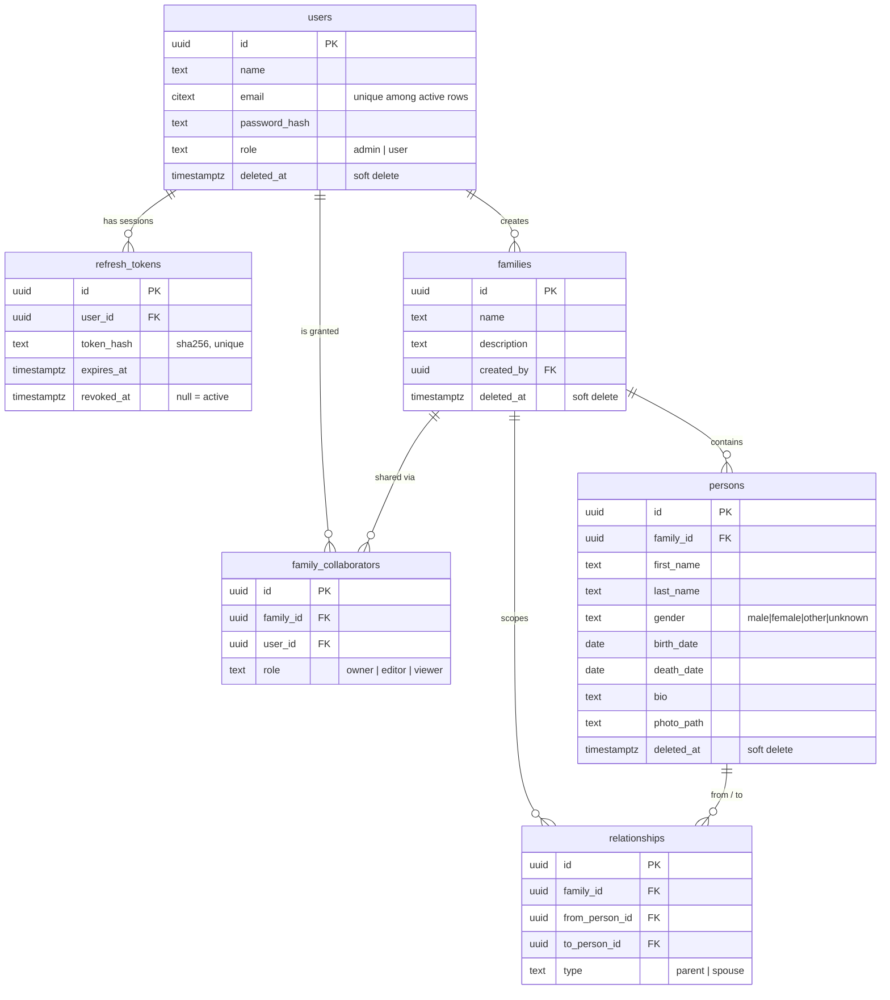

# Database

PostgreSQL 16. Schema owned by SQL migrations (`backend/migrations/`,
golang-migrate — ADR-0003). Conventions: `DEVELOPMENT_RULES.md` §5.

## ERD



## Design decisions

- **UUID PKs** (`gen_random_uuid()` default; services also set IDs in Go for
  explicitness). No sequential IDs leak volume information.
- **Soft delete** (`deleted_at`) on `users`, `families`, `persons` — user
  data must be recoverable. **Hard delete** for `refresh_tokens`,
  `family_collaborators`, `relationships`: sessions and grants are
  re-creatable, and soft-deleted edges would silently corrupt tree
  traversals.
- **Emails** are `citext` with a *partial* unique index
  (`WHERE deleted_at IS NULL`): case-insensitive matching, and a
  soft-deleted account frees its email.
- **Relationship encoding** (`relationships`): `parent` edges are directed
  (from = parent, to = child); `spouse` edges are stored once in canonical
  order (`from_person_id < to_person_id`, CHECK-enforced) so lookups need no
  double-row bookkeeping. Extending types (e.g. `adoptive_parent`) = new
  migration altering the CHECK constraint.
- **Deleting a person**: FK CASCADEs don't fire on soft delete, so the
  service layer must hard-delete the person's edges in the same transaction
  (Phase 3 rule).
- `pg_trgm` is enabled for future name search; add the GIN index in the
  Phase 4 migration that implements search.

## Tree traversal (Phase 3 reference)

Ancestors via recursive CTE (descendants: swap the join direction):

```sql
WITH RECURSIVE ancestors AS (
    SELECT r.from_person_id AS person_id, 1 AS depth
    FROM relationships r
    WHERE r.to_person_id = $1 AND r.type = 'parent'
  UNION ALL
    SELECT r.from_person_id, a.depth + 1
    FROM relationships r
    JOIN ancestors a ON r.to_person_id = a.person_id
    WHERE r.type = 'parent' AND a.depth < $2   -- depth limit
)
SELECT p.*, a.depth
FROM ancestors a
JOIN persons p ON p.id = a.person_id AND p.deleted_at IS NULL;
```

The parent-cycle guard when creating `parent` edges runs the same CTE from
the prospective parent upward and rejects if it reaches the child.

## Migration workflow

```bash
cd backend
go run ./cmd/migrate new add_person_nickname   # creates 0000NN_*.up/.down.sql
# write SQL, then:
go run ./cmd/migrate up
go run ./cmd/migrate version
```

Startup behavior: the API applies pending migrations when
`RUN_MIGRATIONS=true` (default; fine for the single-instance deployment).

**Dirty state recovery**: a failed migration marks `schema_migrations`
dirty and blocks further runs. Inspect the DB, finish/undo the partial
change manually, then `go run ./cmd/migrate force <last-good-version>` and
re-run `up`.

## Backups

`pg_dump` runbook and cron example: `docs/DEPLOYMENT.md` §Backups.
